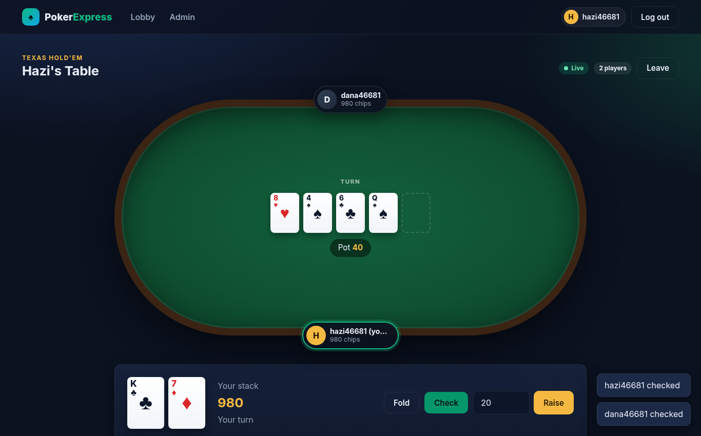
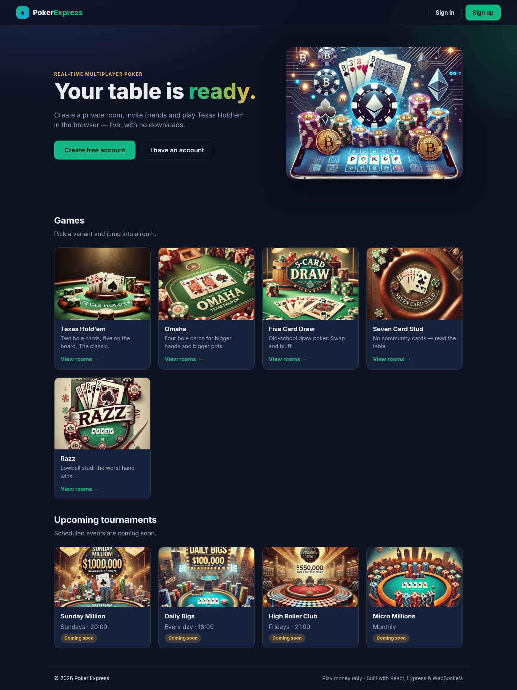
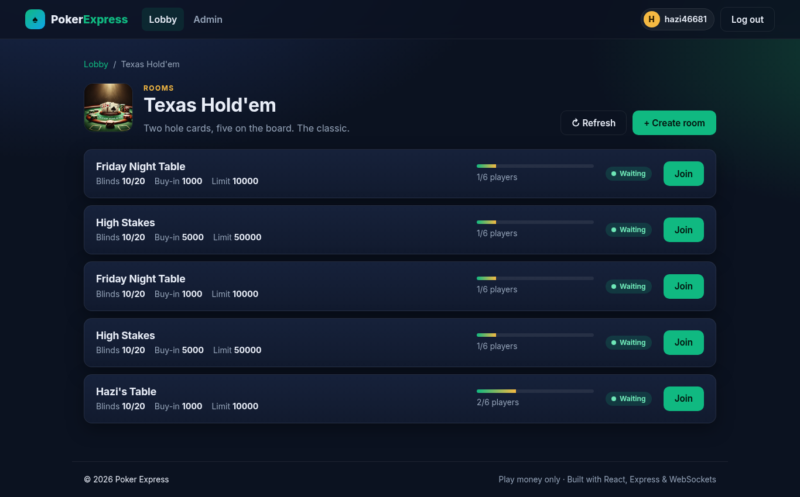
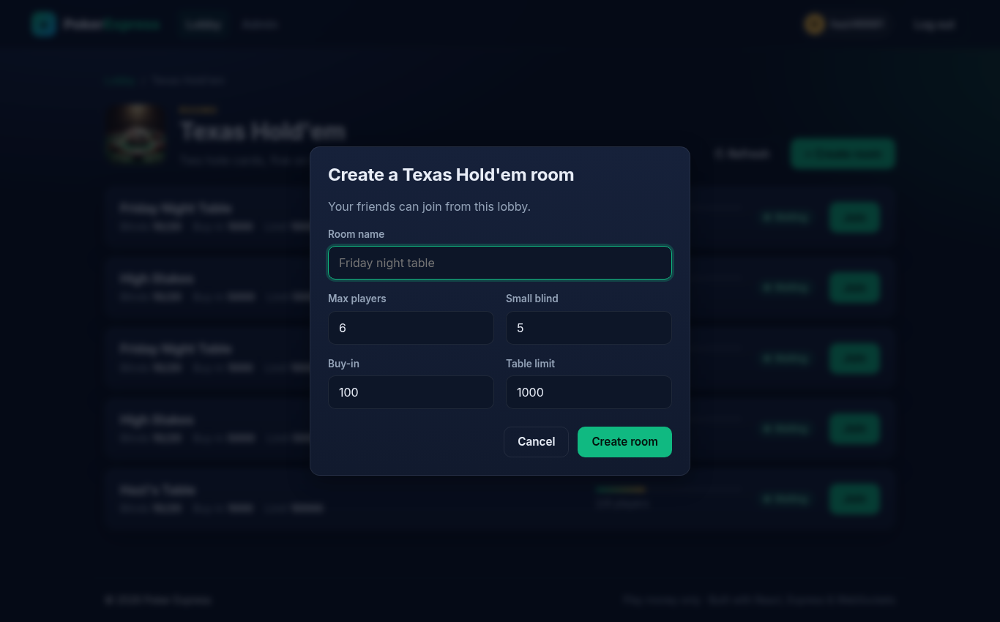
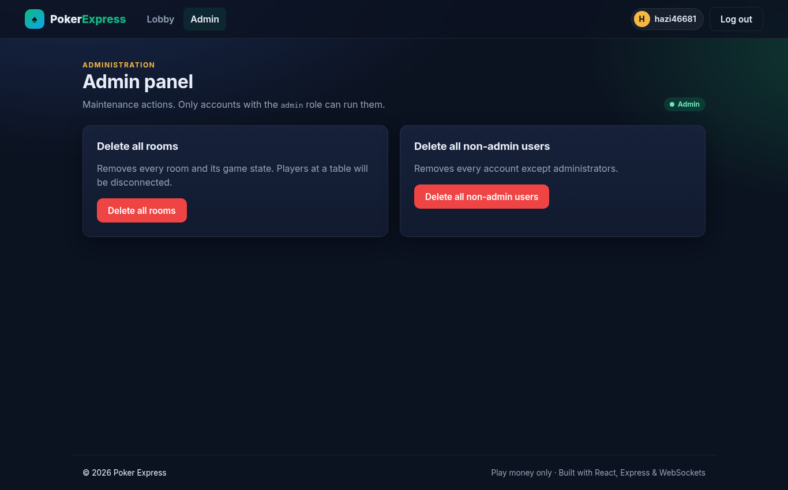
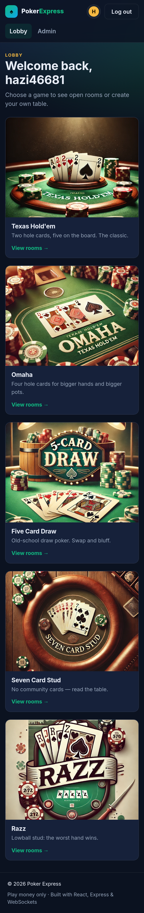
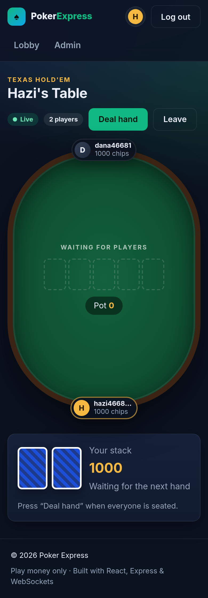

# Poker Express

Real-time multiplayer poker in the browser. Create a room, invite friends, and play Texas Hold'em live over WebSockets.



## Features

- Accounts with hashed passwords (bcrypt) and JWT sessions
- A lobby of game variants, with rooms per variant (blinds, buy-in, table limit, seats)
- A live table over WebSockets: blinds, check/call/raise/fold, flop/turn/river, and showdown with real hand ranking
- Server-side validation of every request and socket message; a player can only act on their own turn
- An admin panel (admin role only) that can wipe rooms and game states
- A responsive UI that works on mobile

> Only Texas Hold'em is playable today. Other variants appear in the lobby but use the Hold'em engine.

## Stack

| Part   | Tech |
|--------|------|
| Server | Node.js 18+, Express, `ws`, Mongoose (MongoDB), zod, helmet, express-rate-limit |
| Client | React 18 (Create React App), React Router 6 |
| Tests  | Jest, Supertest, mongodb-memory-server, React Testing Library |

## Getting started

Requirements: Node.js 18+ and a MongoDB instance (local, Docker, or Atlas).

```bash
# 1. Server
npm install
cp server/.env.example server/.env
# then set JWT_SECRET in server/.env (the server refuses to start without it):
node -e "console.log(require('crypto').randomBytes(48).toString('hex'))"
npm run dev            # http://localhost:5003

# 2. Client (in a second terminal)
cd client
npm install
cp .env.example .env   # optional: only needed if the API is not on localhost:5003
npm start              # http://localhost:3000
```

Quick MongoDB with Docker: `docker run -d -p 27017:27017 mongo:7`

### Making an admin

New accounts are regular users. To promote one:

```bash
npm run make-admin -- <username>
```

## Configuration

Server (`server/.env`):

| Variable | Required | Default | Notes |
|---|---|---|---|
| `JWT_SECRET` | **yes** | – | At least 32 characters in production |
| `MONGODB_URI` | no | `mongodb://127.0.0.1:27017/webpoker` | |
| `PORT` | no | `5003` | |
| `JWT_EXPIRES_IN` | no | `1h` | |
| `FRONTEND_URL` | no | `http://localhost:3000` | Comma-separated CORS allow-list |
| `LOG_LEVEL` | no | `info` | `silent`, `error`, `warn`, `info`, or `debug` |

Client (`client/.env`): `REACT_APP_API_URL` (default `http://localhost:5003`).

## Scripts

| Where | Command | What it does |
|---|---|---|
| root | `npm start` / `npm run dev` | Run the server (dev mode restarts on change) |
| root | `npm test` | Server tests: API, WebSocket, and hand evaluation |
| client | `npm start` | Dev server |
| client | `npm test` | Component and auth tests |
| client | `npm run build` | Production build into `client/build` |

CI: a GitHub Actions workflow that runs the server tests, client tests, and the client build is ready at `ci/github-actions-ci.yml`. To turn it on, move it to `.github/workflows/ci.yml`. It isn't there yet because the token that pushed this branch can't write workflow files.

## Screenshots

| Home | Rooms |
|---|---|
|  |  |

| Create a room | Admin |
|---|---|
|  |  |

| Mobile lobby | Mobile table |
|---|---|
|  |  |

## Project layout

```
server/
  app.js            Express app (security headers, CORS, routes, error handling)
  index.js          Entry point: MongoDB + HTTP + WebSocket
  config.js         Environment configuration (fails fast without JWT_SECRET)
  controllers/      Auth, rooms, games, admin, and gameLogic.js (the poker engine)
  websockets/       Real-time table protocol
  validation.js     zod schemas for HTTP bodies and socket messages
  __tests__/        Jest tests
client/src/
  components/pages  Screens
  components/games  Table, seats, cards, and action panel
  lib/              API and auth helpers
```

## License

[MIT](LICENSE)
